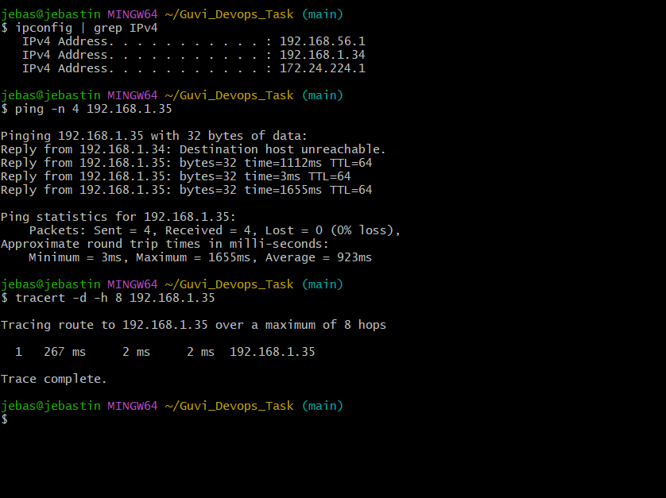
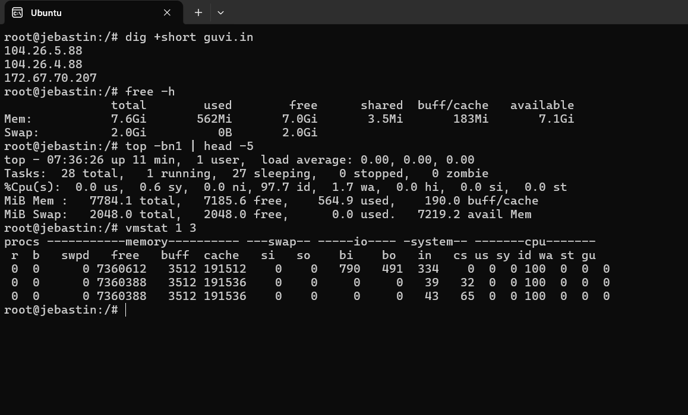
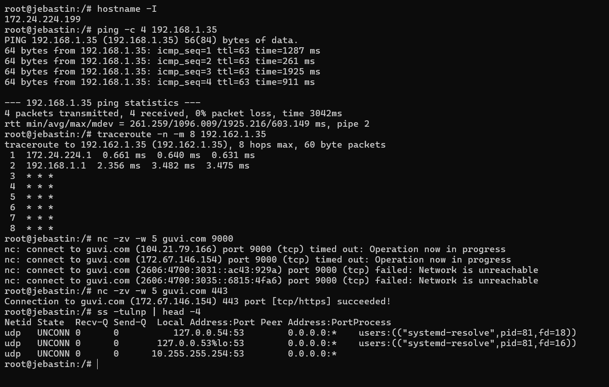
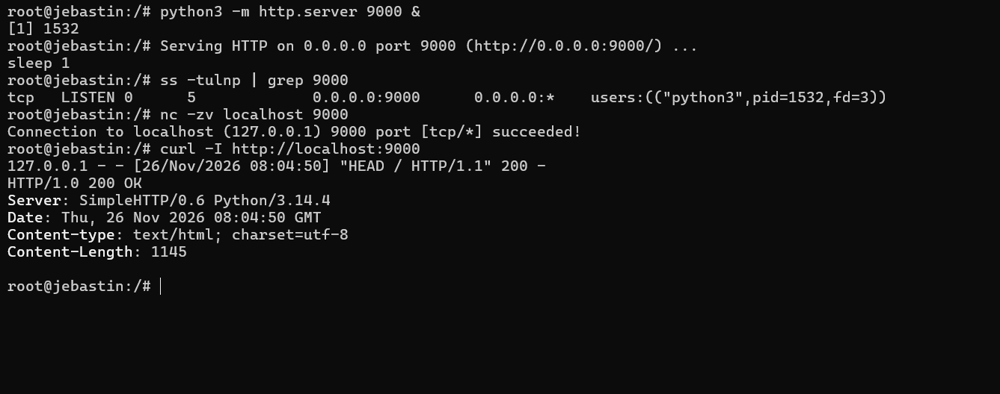

# Guvi DevOps Task - Shell Commands

All commands were run in Git Bash on Windows. Each section lists the commands used, the result and the captured output.

## 1. IP address of guvi.in

Commands: `nslookup guvi.in` and `ping -n 4 guvi.in`

Result: guvi.in resolves to 104.26.4.88, 104.26.5.88 and 172.67.70.207 (plus IPv6 addresses). Ping returned 4 replies with 0% loss.

## 2. CPU and memory usage

Commands: PowerShell `Get-CimInstance Win32_Processor` and `Get-CimInstance Win32_OperatingSystem`

Result: Intel Core i5-12500H at 12% load. Total memory 16,454,388 KB, free 3,799,976 KB (about 77% used).
On a Linux server (AWS or WSL) the equivalent commands are `top`, `free -h` and `vmstat 1 5`.

## 3. Connectivity between two nodes

Commands: `ipconfig`, `ping -n 4 192.168.1.35` and `tracert -d -h 8 192.168.1.35`

Result: Node A (192.168.1.34) reached Node B (192.168.1.35) with 3 successful replies, and the destination was reached in 1 hop.

## 4. Is port 9000 open on guvi.com?

Commands: `timeout 5 bash -c '</dev/tcp/guvi.com/9000'` and `curl -v --connect-timeout 5 http://guvi.com:9000`

Result: Port 9000 is closed or blocked. The connection timed out after 5 seconds. Port 443 on the same host is open, which confirms the test works.

If the app logs say it is running but the page does not load, check that it listens on all interfaces (`sudo ss -tulnp | grep 9000` should show `0.0.0.0:9000`), then allow the port in the firewall (`sudo ufw allow 9000/tcp`) and in the AWS Security Group (inbound rule, Custom TCP, port 9000).

---

# Part 2: The same tasks in WSL (Ubuntu)

The commands below were run in the Ubuntu terminal on WSL, using the Linux tools.

## 5. IP address, CPU and memory (Linux commands)

Commands: `dig +short guvi.in`, `free -h`, `top -bn1 | head -5`, `vmstat 1 3`

Result: guvi.in resolves to 104.26.4.88, 104.26.5.88 and 172.67.70.207, the same as in Git Bash. WSL shows 7.6 GiB total memory (562 MiB used), and the CPU is about 98% idle with a load average of 0.00.

## 6. Connectivity and port checks (Linux commands)

Commands: `hostname -I`, `ping -c 4 192.168.1.35`, `traceroute -n -m 8 192.168.1.35`, `nc -zv -w 5 guvi.com 9000`, `nc -zv -w 5 guvi.com 443`, `ss -tulnp | head -4`

Result: Node A (WSL, 172.24.224.199) pinged Node B (192.168.1.35) with 4 of 4 replies and 0% packet loss. Port 9000 on guvi.com timed out (blocked or closed), while port 443 on the same host succeeded, so the test works and only 9000 is blocked.

## 7. What an open port 9000 looks like

Commands: `python3 -m http.server 9000 &`, `ss -tulnp | grep 9000`, `nc -zv localhost 9000`, `curl -I http://localhost:9000`

Result: a test web server was started on port 9000. `ss` shows it listening on 0.0.0.0:9000, `nc` reports the port open, and `curl` returns HTTP 200 OK. This is the working case, in contrast with the blocked port 9000 on guvi.com in section 4.

Troubleshooting a port that is closed from outside:
1. Confirm the app listens on all interfaces: `ss -tulnp | grep 9000` should show 0.0.0.0:9000, not 127.0.0.1:9000.
2. Allow it in the firewall: `sudo ufw allow 9000/tcp`.
3. On AWS, add an inbound rule to the Security Group (Custom TCP, port 9000).

