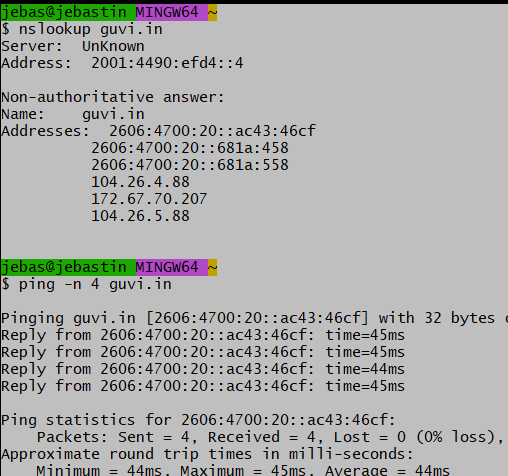
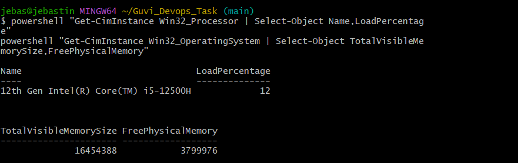
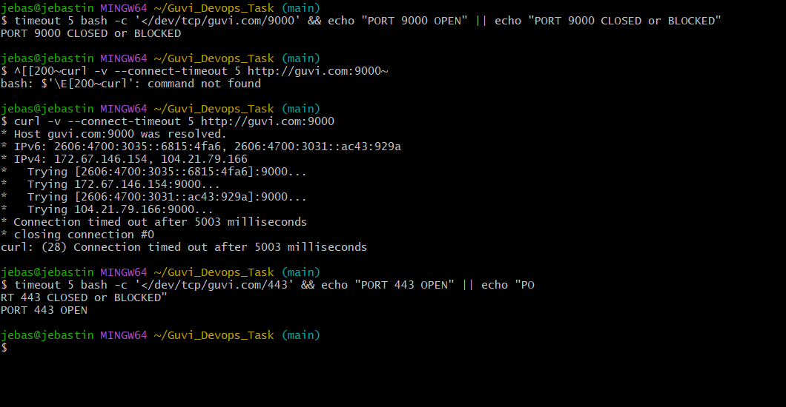

# Guvi DevOps Task - Shell Commands

All commands were run in Git Bash on Windows. Each section lists the commands used, the result and the captured output.

## 1. IP address of guvi.in

Commands: `nslookup guvi.in` and `ping -n 4 guvi.in`

Result: guvi.in resolves to 104.26.4.88, 104.26.5.88 and 172.67.70.207 (plus IPv6 addresses). Ping returned 4 replies with 0% loss.

## 2. CPU and memory usage

Commands: PowerShell `Get-CimInstance Win32_Processor` and `Get-CimInstance Win32_OperatingSystem`

Result: Intel Core i5-12500H at 12% load. Total memory 16,454,388 KB, free 3,799,976 KB (about 77% used).
On a Linux server (AWS or WSL) the equivalent commands are `top`, `free -h` and `vmstat 1 5`.

## 3. Connectivity between two nodes

Commands: `ipconfig`, `ping -n 4 192.168.1.35` and `tracert -d -h 8 192.168.1.35`

Result: Node A (192.168.1.34) reached Node B (192.168.1.35) with 3 successful replies, and the destination was reached in 1 hop.

## 4. Is port 9000 open on guvi.com?

Commands: `timeout 5 bash -c '</dev/tcp/guvi.com/9000'` and `curl -v --connect-timeout 5 http://guvi.com:9000`

Result: Port 9000 is closed or blocked. The connection timed out after 5 seconds. Port 443 on the same host is open, which confirms the test works.

If the app logs say it is running but the page does not load, check that it listens on all interfaces (`sudo ss -tulnp | grep 9000` should show `0.0.0.0:9000`), then allow the port in the firewall (`sudo ufw allow 9000/tcp`) and in the AWS Security Group (inbound rule, Custom TCP, port 9000).

